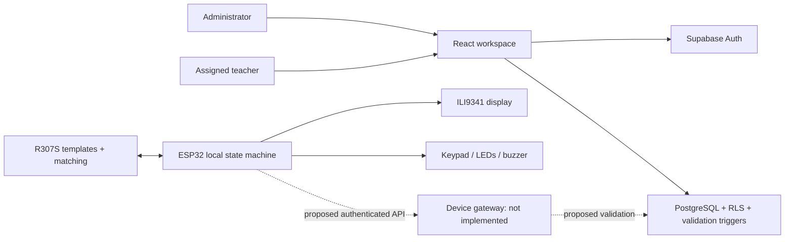

# CampusID implementation and design

Reviewed 16 October 2026. This describes the current source and separates it from proposed hardware/cloud capabilities. Entry point for installation: [README](../README.md).

## 1. Review baseline and evidence

The checkout was on `main`, tracking `origin/main`, at `e47134025e8219ac7a95d86797a7c4e6243e4c09`. It already contained substantial uncommitted attendance, documentation, SQL, and firmware work. Those changes were retained and extended; no reset, commit, push, migration deployment, or physical hardware operation was performed.

The supplied context handover was historical. The actual source already included manual attendance, 16 passing unit tests, and modular local-recognition firmware. The initial production build passed. Git required execution outside the restricted shell because its developer-tool path was unavailable there. Arduino CLI was not available, so firmware compilation and physical behavior remain unverified in this review.

## 2. Architecture

The solid browser/database path supports manual attendance. The ESP32 path is standalone. There is no implemented network link between them, no device heartbeat, and no evidence of cloud fingerprint enrollment. The overview reports these boundaries explicitly.

## 3. Source responsibilities

| Source | Responsibility |
| --- | --- |
| [App.tsx](../src/App.tsx) | Auth lifecycle, role lookup, directory loading, navigation, administrator registration and activation |
| [Overview.tsx](../src/components/Overview.tsx) | Typed summary metrics, role-aware next actions, truthful system readiness |
| [AttendanceWorkspace.tsx](../src/components/AttendanceWorkspace.tsx) | Class/date session, search/filter, progress, request locking and reconciliation |
| [attendance.ts](../src/lib/attendance.ts) | Attendance queries, inserts/corrections, event IDs, error outcomes and summary calculation |
| [admin.ts](../src/lib/admin.ts) | Input validation and database error translation |
| [types.ts](../src/lib/types.ts) | Shared class/person/navigation/notice contracts |
| [configuration.ts](../src/lib/configuration.ts) | Missing/malformed configuration checks before constructing Supabase |
| [supabase.ts](../src/lib/supabase.ts) | Browser client using public environment variables |
| [styles.css](../src/styles.css) | Design tokens, responsive layouts, focus states and reduced motion |
| [campusid-terminal.ino](../firmware/campusid-terminal/campusid-terminal.ino) | Terminal boot, screens, input routing, recognition events |
| Firmware service/adapter modules | UART recognition, display drawing, keypad scanning and timed feedback |

Component extraction removes attendance and overview presentation from the original monolithic app. Directory forms remain in App for now; splitting them further is a reasonable next maintenance step if editing/import workflows are introduced. No new UI framework or charting dependency was added. Prettier provides consistent formatting; TypeScript checks types, but a dedicated ESLint setup is not included.

## 4. Browser workflows

### Authentication and data isolation

The browser restores a Supabase Auth session, queries `current_user_role`, and only shows the workspace to `administrator` or `teacher`. Role provisioning happens outside the browser. UI role checks improve usability; PostgreSQL RLS is the authorization boundary.

A user identity change clears directory data, forms, notices, and role state. Asynchronous directory responses and writes carry a session generation check; older responses cannot overwrite a different account. Directory refreshes also have a request generation so an older refresh cannot win. A token refresh for the same user does not reset the active attendance workspace. Roles are looked up when identity changes; after changing a role externally, sign out/in to reload the role UI. RLS continues to enforce current permissions on every request.

Attendance is keyed by user ID and kept mounted while navigating sections. Unmounting invalidates pending attendance responses. It has a synchronous request lock in addition to disabled buttons, preventing two immediate clicks from scheduling duplicate writes. Administrator mutations have their own synchronous lock.

### Records and registration

Classes load separately from people and teacher assignments to avoid ambiguous PostgREST relationships. Students belong to one class. Teacher registration uses the transactional `register_teacher_with_classes` RPC with deduplicated class IDs. Validation rejects blank names/identifiers and missing required assignments. People have explicit activation state; no delete workflow is exposed.

Teachers see scoped records without admin registration forms or activation actions. Switching directory sections clears shared search/form input so a student identifier cannot accidentally carry over into teacher registration. Search is local and case-insensitive. The prototype loads the visible directory into memory; pagination and server-side search remain necessary before using large institutional rosters.

### Attendance

1. Select a visible class and browser-local calendar date.
2. Load existing records and open the session. Class/date stay locked until closing it.
3. Show present, late, excused, absent, and unmarked counts. Inactive people without records do not inflate the unmarked count. Historical records for currently inactive roster members remain visible.
4. Mark or correct a status. Selecting an already selected status is disabled. Corrections send only the `status` field.
5. Update the row from the server's confirmed response. The UI does not optimistically claim a write succeeded.
6. On a rejected or uncertain write, reload server state. A confirmed matching client event identifies an interrupted insert that actually succeeded. Unresolved transport failures retain the same event ID for a retry in this workspace.
7. Refresh explicitly to reconcile changes from other browsers. This is not a realtime subscription.
8. Close the session without deleting records. Browser reload/sign-out discards workspace state; database records persist.

The progress denominator includes active roster members plus inactive roster members with a saved record. Unmarked means no record; it is never silently converted to absent. A student moved to a different class will no longer appear in the previous class's current roster; a separate historical reporting view is not implemented.

An in-memory event ID map is **not an offline queue**. It does not survive browser reload. Concurrent corrections currently use database last-write-wins behavior, with audit rows; optimistic concurrency checking remains a future enhancement.

## 5. Database contract and boundaries

| Table | Purpose / invariant |
| --- | --- |
| `classes` | Academic class/section metadata |
| `people` | Student/teacher identities, identifiers, class and activation state |
| `teacher_classes` | Teacher-to-class assignments |
| `user_roles` | Auth user to application role/person mapping |
| `fingerprint_mappings` | Protected sensor-slot mappings; browser has no access |
| `attendance_records` | Unique student/class/date plus optional unique client event UUID |
| `attendance_record_audit` | Correction history readable by administrators |

Attendance inserts require the current Auth user as recorder. Validation requires an active student assigned to the selected class. Teachers can read/write/correct attendance only in assigned classes; administrators can act across classes. Recorder attribution is immutable, and status/class/student corrections produce audit records.

The existing SQL permits authorized updates to more than status at the table level. The current UI only updates status. The trigger protects recorder attribution, but date/client event identity are not fully immutable, and date-only changes are not audited. Harden these columns and audit coverage in a separately reviewed migration before device ingestion. No schema change was made in this review. Existing SQL verification scripts should be rerun in a disposable deployment; earlier engineering notes are historical test evidence, not a hosted deployment guarantee.

The current unique key allows one attendance record per class/day/student, not multiple lessons. Decide whether the expo actually needs multiple daily sessions before introducing persistent sessions. If it does, migrate deliberately to session-scoped uniqueness instead of silently reusing the date-only model.

## 6. Interface design

The visual direction uses a deep green navigation rail, pale green workspace, restrained mint accents, white cards, and clear typography. The terminal illustration is CSS and Lucide icons rather than a downloaded raster asset. It is decorative, hidden from assistive technology, and does not represent a live device.

- Overview emphasizes the next useful action and setup progress, with actual database counts.
- Attendance emphasizes the selected class, progress, status and unmarked students.
- System status distinguishes database connectivity, unintegrated terminal, and planned sync.
- Inputs/buttons use a 44 px minimum target, visible focus and readable text. Mobile form inputs use 16 px text to avoid automatic zoom on iOS.
- Main navigation has `aria-current`, search inputs have accessible names, tables have column scopes and focusable scroll regions, notices use status/alert roles, and the page has a skip link.
- Desktop uses a fixed sidebar. Below 700 px, navigation becomes a horizontal strip and account/sign-out stay visible. Forms stack; directory tables scroll within their own region, and attendance rows become cards with all four marking actions visible.
- Overview grids adapt at 1200 px; attendance controls simplify at 900 px. Status counts wrap rather than squeeze.
- Motion is limited to feedback transitions and request spinners; `prefers-reduced-motion` disables both. System fonts remove the external Google Fonts request.

These changes improve accessibility but do not constitute a full WCAG audit. Keyboard, screen-reader, and real-device checks should accompany the expo rehearsal.

## 7. Firmware implementation and review findings

The entry sketch initializes Serial, R307S UART2, keypad, output feedback, and TFT. Recognition runs through initializing → ready → scan → matched/no match → finger removal, with reconnect attempts on sensor communication failures. The service waits for finger removal to avoid repeated matches from one placement. Adafruit serial calls are synchronous; the scheduled service loop is not a guarantee of hard realtime latency.

Local matches expose only template ID and sensor confidence. Confidence is not a calibrated identity probability. No sensor template is exported, enrolled, deleted or mapped by this firmware.

Changes made during this review:

- Portrait rotation now matches the 240×320 screen coordinates.
- Device ID, keypad diagnostics and menu/status text fit the portrait width more reliably.
- Display status says API initialized rather than claiming electrical verification; Adafruit initialization returns no proof that a physical TFT is connected.
- Rejection feedback holds the buzzer/LED for 180 ms before switching off. The original code turned it off in the same update call.
- Feedback scheduling uses wrap-safe elapsed comparisons.
- Image-quality errors take the removal/retry path instead of falsely reporting a serial disconnection.
- Unrecognized scans trigger rejection feedback.
- A standalone TFT regression sketch preserves the reported working six-argument constructor and pins.

The combined firmware pin map was **not silently changed**. Its CS/DC/reset differ from the supplied working configuration, and the working DC pin conflicts with the combined buzzer pin. The [hardware roadmap](EXPO_ROADMAP.md) records the decision required before integration. Recognition-only success feedback is not proof of attendance accepted by a server.

## 8. Verification and next gates

`npm run check` covers strict TypeScript compilation, 25 unit tests, Prettier, and production build. Service tests cover summary scoping, stable retry IDs, duplicate rejection, lost insert/correction responses, and status-only corrections. Configuration tests cover missing fields, invalid URL protocols/credentials, localhost and secret-key prefixes.

Browser validation uses temporary in-browser mocked Auth/database responses, not real student rows. It can verify presentation, session behavior, role-aware controls and request handling, but cannot prove server authorization. No hosted database writes or migrations are part of this review.

Completed browser checks in this review:

- All five sections at 320, 390, 768, 1024 and 1440 px: no page-level horizontal overflow. The active roster was checked at the same widths; desktop overview and phone attendance were visually inspected.
- Two immediate attendance clicks: exactly one mocked insert, confirmed status and completion count.
- Unmarked filter: excludes the marked student and an inactive student without a record.
- Navigation away/back: the active class session remains open.
- Teacher role: no registration forms or activation controls on classes/students/teachers screens.
- Lost response after a committed insert: reload identifies the matching event and reports the saved status.
- Delayed attendance response after sign-out: sign-in screen remains visible and no stale success notice appears.

These were browser smoke checks with temporary fetch fixtures, not a committed automated end-to-end suite. The unit suite is reproducible with `npm test`. The final production build generated approximately 116 kB gzipped JavaScript and 4.6 kB gzipped CSS. Firmware compilation, on-board timing, and hosted SQL tests were not rerun here.

Before claiming an end-to-end expo system:

1. Compile firmware against recorded library/board versions and resolve the TFT/buzzer pin conflict.
2. Verify TFT and R307S independently, then together on the physical board.
3. Apply and verify the reviewed schema only in a disposable project first.
4. Implement the authenticated device path and enrollment lifecycle.
5. Test interrupted writes, power loss, reboot, wrong-class scans and replay on actual hardware.

The [expo roadmap](EXPO_ROADMAP.md) defines the smallest useful sequence and measurable acceptance criteria.
